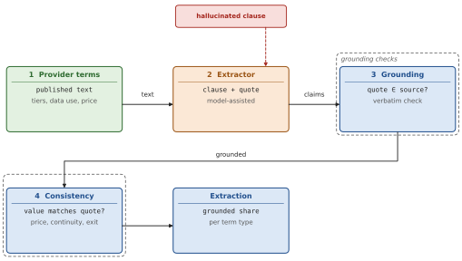
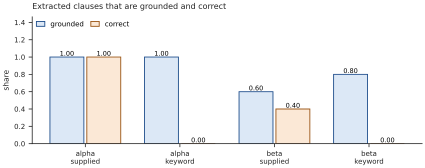

# Demo 69: Is Every Extracted Clause in the Source? Grounding Checks for Model-Assisted Extraction of AI Service Access Terms

> **▶️ New here? Follow the step-by-step [Execution Instructions](INSTRUCTIONS.md)** — every command with expected output.

**Status (19 November 2026):** design stage. A teaching toy with labelled synthetic fixtures runs offline and its tests pass. **No pilot data have been collected and no results exist.** Every study quantity is `[RESULT PENDING]`.

## Research question

When a language model extracts the access terms of an AI service (tier, use of customer data, price, continuity and exit) from the provider's published terms, what share of extracted fields is supported by a quote that exists in the source and is consistent with the extracted value, and how many errors does a mechanical grounding check catch before a person checks the clause?

## Why it matters

Registers of the terms on which institutions obtain AI services are increasingly built with model-assisted extraction. A register is only as reliable as its traceability: a fluent but fabricated clause about data use or notice periods is worse than a gap. A mechanical check that each field quotes its source focuses human checking on the fields that need it.

## Design of the pilot study

| Arm or control | What it is |
|---|---|
| Model extraction | fields and supporting quotes extracted by a free or local open-weight model |
| Keyword baseline | the first sentence that mentions each field's cue words |
| Grounding check | verbatim-quote match after normalisation, value-quote consistency, and agreement with a hand-labelled gold value |

**Outcomes**
- primary: share of extracted fields that are grounded and consistent
- secondary: fabricated-quote rate; accuracy against gold labels; share of model errors the mechanical check catches

**How the pilot runs.** Public terms pages of AI services offered to education, captured with dated Internet Archive snapshots; extraction by a free or local open-weight model; gold labels for a sample written by the author before the model output is seen. No documents obtained under information-access requests and no personal data. The steps are in [`ZCODE_PROMPT.md`](ZCODE_PROMPT.md); the study is registered in `docs/` before the first real run.

**Data.** Synthetic terms documents in the toy; public terms pages and their archive captures in the pilot.

## The teaching toy

`student/grounding.py` implements the measurement on `fixtures/terms.json`; `student/run_grounding.py` prints one line per case and writes `results/grounding.json`. Every number it prints belongs to the toy fixture and is not evidence about any real system, dataset or population.

## Learning Objectives

- State the measurement question and the registered primary outcome
- Run the offline procedure on the labelled synthetic fixture
- Explain which control or baseline makes the outcome interpretable
- Distinguish the teaching output from a confirmatory research result

<!-- BEGIN generated: how-it-works (tools/figures/docs.py) -->
## How it works

**Figure 1.** Every extracted clause must be found verbatim in the source before its value is trusted. Numbered boxes are stages (role on top, rule or variable beneath, in monospace); dashed grey panels mark a trust domain or scope; a dashed red arrow marks where an adversary acts. Teaching schematic: it simplifies the research procedure and leaves out its corpora, models and thresholds.

### Step by step

1. **Provider terms** (`published text`). Tiers, data use, price. In this demo: `fixtures/`.
2. **Extractor** (`clause + quote`). Model-assisted. In this demo: `fixtures/`.
3. **Grounding** (`quote ∈ source?`). Verbatim check. In this demo: `student/grounding.py`.
4. **Consistency** (`value matches quote?`). Price, continuity, exit. In this demo: `student/run_grounding.py`.
5. **Extraction** (`grounded share`). Per term type. Run `make demo` to print it.

**Figure 2.** A keyword baseline can quote the source verbatim and still extract the wrong value; grounding is necessary, not sufficient. Values come from `make demo` on the synthetic fixture: they are illustrative and are not research results.

### What the research version adds (withheld while under peer review)

- Providers' published terms
- Design stage

The study's data, exact protocol, thresholds and results are not part of this teaching demo. They will be linked here once the paper is published open access.

<!-- END generated: how-it-works -->

## Venues

| Option | Venue | Dates and rules |
|---|---|---|
| A | <a href="https://www.usenix.org/conference/usenixsecurity27/call-for-papers" target="_blank" rel="noopener noreferrer">USENIX Security '27, Cycle 2</a> | mandatory registration 19 Jan 2027; papers 26 Jan 2027; early reject 9 Mar 2027; rebuttal 8 to 15 Apr 2027; notification 6 May 2027 (all AoE). up to 13 pages of body text plus unlimited appendices and references; Open Science appendix required; ethics appendix recommended; at most seven papers per author per cycle; ML-focused work must be relevant to the systems security and privacy community (official CFP read 19 Nov 2026). The README already allocates six Cycle 2 papers, so this one fills the cap |
| B | <a href="https://dl.acm.org/journal/tops" target="_blank" rel="noopener noreferrer">ACM Transactions on Privacy and Security (TOPS)</a> | rolling submission. use only after USENIX Security's notification on 6 May 2027 |
| C | <a href="https://petsymposium.org/" target="_blank" rel="noopener noreferrer">PoPETs 2028</a> | call not yet published (UNVERIFIED). use only after ACM TOPS' decision; record the official call before relying on any date |

B and C are sequential fallbacks: each is used only after the previous option's official notification, so the same work is never under review in two places. Paste-ready fields are in `submission/option-A/`, `option-B/` and `option-C/` (`REGISTRATION.md`).

**Risks for the venue plan**
- Taking USENIX Security '27 Cycle 2 fills the seven-paper cap for that cycle (six already allocated in the README); if another demo needs the slot, option A should move to ACL 2027 through ARR (4 Jan 2027).

## Safety Notice

⚠️ **This is a teaching demonstration using synthetic fixtures only.**
- No real people, credentials, production systems or provider accounts
- No network access in the toy (standard library only)
- Results demonstrate a mechanism; they are not evidence about real deployments

## Reproducibility metadata

| Field | Value |
|-------|-------|
| Seed | 69 where randomness is used |
| Python | 3.11+ (standard library only) |
| Command | `make demo DEMO=69` |

## Author

Petar Radanliev, The Open University (ORCID [0000-0001-5629-6857](https://orcid.org/0000-0001-5629-6857)).
