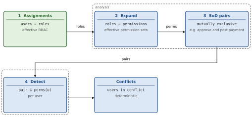
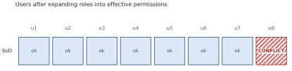

# Demo 70: Separation-of-duty Conflicts in Role-Based Access Control

> **▶️ New here? Follow the step-by-step [Execution Instructions](INSTRUCTIONS.md)** — every command with expected output.

## Learning Objectives

- Explain the measurement question of this teaching demonstration
- Run the offline procedure on the labelled synthetic fixture
- Distinguish the teaching output from a confirmatory research result
- Name the target venue and why the topic is scoped to that venue

<!-- BEGIN generated: how-it-works (tools/figures/docs.py) -->
## How it works

**Figure 1.** Separation-of-duty conflicts appear only after roles are expanded into effective permissions. Numbered boxes are stages (role on top, rule or variable beneath, in monospace); dashed grey panels mark a trust domain or scope; a dashed red arrow marks where an adversary acts. Teaching schematic: it simplifies the research procedure and leaves out its corpora, models and thresholds.

### Step by step

1. **Assignments** (`users → roles`). Effective RBAC. In this demo: `fixtures/`.
2. **Expand** (`roles → permissions`). Effective permission sets. In this demo: `student/sod.py`.
3. **SoD pairs** (`mutually exclusive`). E.g. approve and post payment. In this demo: `student/sod.py`.
4. **Detect** (`pair ⊆ perms(u)`). Per user. In this demo: `student/run_sod.py`.
5. **Conflicts** (`users in conflict`). Deterministic. Run `make demo` to print it.

**Figure 2.** One user holds both approve-payment and post-payment once roles are expanded. Values come from `make demo` on the synthetic fixture: they are illustrative and are not research results.

### What the research version adds (withheld while under peer review)

- Public access-control datasets
- Scaling to large role graphs

The study's data, exact protocol, thresholds and results are not part of this teaching demo. They will be linked here once the paper is published open access.

<!-- END generated: how-it-works -->

## Conceptual Explanation

Deterministic detection of mutually exclusive permission pairs in effective RBAC assignments. The fixture holds 8 labelled synthetic cases.
Running `student/run_sod.py` prints one row per case and writes
`results/sod.json`. Every number produced here belongs to the
toy fixture; it is not evidence about a live system or an external corpus.

Target venue (option A): **Computers & Security**. Options B and C are
sequential fallbacks and are recorded in `venue.yaml`.

## Safety Notice

⚠️ **This is a teaching demonstration using synthetic fixtures only.**
- No real vulnerabilities, credentials, or production systems
- No network access (standard library only)
- All cases and verdicts are hand-built toys
- Results demonstrate a mechanism; they are not evidence about real deployments

## Reproducibility Metadata

| Field | Value |
|-------|-------|
| Seed | 70 (fixed; no randomness used) |
| Python | 3.11+ (stdlib only) |
| OS | Linux/macOS/Windows |
| Command | `make demo DEMO=70` |

## Research Connection

This demo illustrates the measurement question of a pending study aimed at
Computers & Security. That study has collected no confirmatory data; every
quantity there is `[RESULT PENDING]`. Nothing here describes a publication,
a venue result, or a measured effect size.
