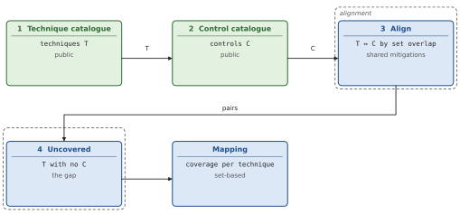
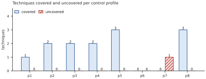

# Demo 72: Knowledge-Base Alignment of Adversary Techniques to Compensating Controls

> **▶️ New here? Follow the step-by-step [Execution Instructions](INSTRUCTIONS.md)** — every command with expected output.

## Learning Objectives

- Explain the measurement question of this teaching demonstration
- Run the offline procedure on the labelled synthetic fixture
- Distinguish the teaching output from a confirmatory research result
- Name the target venue and why the topic is scoped to that venue

<!-- BEGIN generated: how-it-works (tools/figures/docs.py) -->
## How it works

**Figure 1.** Techniques are aligned to compensating controls by the mitigations they share. Numbered boxes are stages (role on top, rule or variable beneath, in monospace); dashed grey panels mark a trust domain or scope; a dashed red arrow marks where an adversary acts. Teaching schematic: it simplifies the research procedure and leaves out its corpora, models and thresholds.

### Step by step

1. **Technique catalogue** (`techniques T`). Public. In this demo: `fixtures/`.
2. **Control catalogue** (`controls C`). Public. In this demo: `fixtures/`.
3. **Align** (`T ↔ C by set overlap`). Shared mitigations. In this demo: `student/mapping.py`.
4. **Uncovered** (`T with no C`). The gap. In this demo: `student/run_mapping.py`.
5. **Mapping** (`coverage per technique`). Set-based. Run `make demo` to print it.

**Figure 2.** Set overlap shows which techniques each control profile leaves uncovered. Values come from `make demo` on the synthetic fixture: they are illustrative and are not research results.

### What the research version adds (withheld while under peer review)

- Full public catalogues
- An evaluation against expert mappings

The study's data, exact protocol, thresholds and results are not part of this teaching demo. They will be linked here once the paper is published open access.

<!-- END generated: how-it-works -->

## Conceptual Explanation

Set-based alignment of public technique catalogues to public control catalogues. The fixture holds 8 labelled synthetic cases.
Running `student/run_mapping.py` prints one row per case and writes
`results/mapping.json`. Every number produced here belongs to the
toy fixture; it is not evidence about a live system or an external corpus.

Target venue (option A): **ACM TIST**. Options B and C are
sequential fallbacks and are recorded in `venue.yaml`.

## Safety Notice

⚠️ **This is a teaching demonstration using synthetic fixtures only.**
- No real vulnerabilities, credentials, or production systems
- No network access (standard library only)
- All cases and verdicts are hand-built toys
- Results demonstrate a mechanism; they are not evidence about real deployments

## Reproducibility Metadata

| Field | Value |
|-------|-------|
| Seed | 72 (fixed; no randomness used) |
| Python | 3.11+ (stdlib only) |
| OS | Linux/macOS/Windows |
| Command | `make demo DEMO=72` |

## Research Connection

This demo illustrates the measurement question of a pending study aimed at
ACM TIST. That study has collected no confirmatory data; every
quantity there is `[RESULT PENDING]`. Nothing here describes a publication,
a venue result, or a measured effect size.
