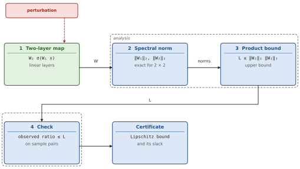
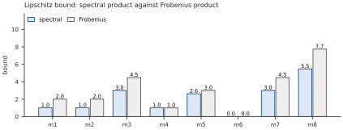

# Demo 74: Spectral-Norm Lipschitz Bounds for Two-Layer Linear Maps

> **▶️ New here? Follow the step-by-step [Execution Instructions](INSTRUCTIONS.md)** — every command with expected output.

## Learning Objectives

- Explain the measurement question of this teaching demonstration
- Run the offline procedure on the labelled synthetic fixture
- Distinguish the teaching output from a confirmatory research result
- Name the target venue and why the topic is scoped to that venue

<!-- BEGIN generated: how-it-works (tools/figures/docs.py) -->
## How it works

**Figure 1.** The product of spectral norms bounds how far a perturbation can move the output. Numbered boxes are stages (role on top, rule or variable beneath, in monospace); dashed grey panels mark a trust domain or scope; a dashed red arrow marks where an adversary acts. Teaching schematic: it simplifies the research procedure and leaves out its corpora, models and thresholds.

### Step by step

1. **Two-layer map** (`W₂ σ(W₁ x)`). Linear layers. In this demo: `fixtures/`.
2. **Spectral norm** (`‖W₁‖₂, ‖W₂‖₂`). Exact for 2 × 2. In this demo: `student/lipschitz.py`.
3. **Product bound** (`L ≤ ‖W₂‖₂ ‖W₁‖₂`). Upper bound. In this demo: `student/lipschitz.py`.
4. **Check** (`observed ratio ≤ L`). On sample pairs. In this demo: `student/run_lipschitz.py`.
5. **Certificate** (`Lipschitz bound`). And its slack. Run `make demo` to print it.

**Figure 2.** The spectral product is never looser than the Frobenius product, and is much tighter for some maps. Values come from `make demo` on the synthetic fixture: they are illustrative and are not research results.

### What the research version adds (withheld while under peer review)

- Deeper networks
- Tighter bounds than the product

The study's data, exact protocol, thresholds and results are not part of this teaching demo. They will be linked here once the paper is published open access.

<!-- END generated: how-it-works -->

## Conceptual Explanation

Exact two-by-two spectral norms and the product Lipschitz bound of a two-layer linear map. The fixture holds 8 labelled synthetic cases.
Running `student/run_lipschitz.py` prints one row per case and writes
`results/lipschitz.json`. Every number produced here belongs to the
toy fixture; it is not evidence about a live system or an external corpus.

Target venue (option A): **IEEE TNNLS**. Options B and C are
sequential fallbacks and are recorded in `venue.yaml`.

## Safety Notice

⚠️ **This is a teaching demonstration using synthetic fixtures only.**
- No real vulnerabilities, credentials, or production systems
- No network access (standard library only)
- All cases and verdicts are hand-built toys
- Results demonstrate a mechanism; they are not evidence about real deployments

## Reproducibility Metadata

| Field | Value |
|-------|-------|
| Seed | 74 (fixed; no randomness used) |
| Python | 3.11+ (stdlib only) |
| OS | Linux/macOS/Windows |
| Command | `make demo DEMO=74` |

## Research Connection

This demo illustrates the measurement question of a pending study aimed at
IEEE TNNLS. That study has collected no confirmatory data; every
quantity there is `[RESULT PENDING]`. Nothing here describes a publication,
a venue result, or a measured effect size.
