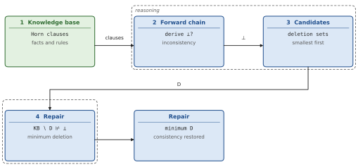
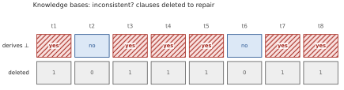

# Demo 77: Minimum Horn-Clause Deletion to Restore Consistency

> **▶️ New here? Follow the step-by-step [Execution Instructions](INSTRUCTIONS.md)** — every command with expected output.

## Learning Objectives

- Explain the measurement question of this teaching demonstration
- Run the offline procedure on the labelled synthetic fixture
- Distinguish the teaching output from a confirmatory research result
- Name the target venue and why the topic is scoped to that venue

<!-- BEGIN generated: how-it-works (tools/figures/docs.py) -->
## How it works

**Figure 1.** The smallest set of clauses whose deletion stops the derivation of falsehood restores consistency. Numbered boxes are stages (role on top, rule or variable beneath, in monospace); dashed grey panels mark a trust domain or scope; a dashed red arrow marks where an adversary acts. Teaching schematic: it simplifies the research procedure and leaves out its corpora, models and thresholds.

### Step by step

1. **Knowledge base** (`Horn clauses`). Facts and rules. In this demo: `fixtures/`.
2. **Forward chain** (`derive ⊥?`). Inconsistency. In this demo: `student/horn.py`.
3. **Candidates** (`deletion sets`). Smallest first. In this demo: `student/horn.py`.
4. **Repair** (`KB ∖ D ⊬ ⊥`). Minimum deletion. In this demo: `student/run_horn.py`.
5. **Repair** (`minimum D`). Consistency restored. Run `make demo` to print it.

**Figure 2.** Each inconsistent knowledge base is repaired by the smallest deletion that stops forward chaining from deriving falsehood. Values come from `make demo` on the synthetic fixture: they are illustrative and are not research results.

### What the research version adds (withheld while under peer review)

- Larger knowledge bases
- Complexity analysis

The study's data, exact protocol, thresholds and results are not part of this teaching demo. They will be linked here once the paper is published open access.

<!-- END generated: how-it-works -->

## Conceptual Explanation

Smallest clause-deletion set that stops forward chaining from deriving false. The fixture holds 8 labelled synthetic cases.
Running `student/run_horn.py` prints one row per case and writes
`results/horn.json`. Every number produced here belongs to the
toy fixture; it is not evidence about a live system or an external corpus.

Target venue (option A): **Artificial Intelligence**. Options B and C are
sequential fallbacks and are recorded in `venue.yaml`.

## Safety Notice

⚠️ **This is a teaching demonstration using synthetic fixtures only.**
- No real vulnerabilities, credentials, or production systems
- No network access (standard library only)
- All cases and verdicts are hand-built toys
- Results demonstrate a mechanism; they are not evidence about real deployments

## Reproducibility Metadata

| Field | Value |
|-------|-------|
| Seed | 77 (fixed; no randomness used) |
| Python | 3.11+ (stdlib only) |
| OS | Linux/macOS/Windows |
| Command | `make demo DEMO=77` |

## Research Connection

This demo illustrates the measurement question of a pending study aimed at
Artificial Intelligence. That study has collected no confirmatory data; every
quantity there is `[RESULT PENDING]`. Nothing here describes a publication,
a venue result, or a measured effect size.
