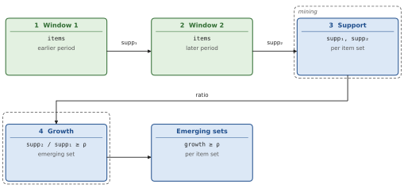
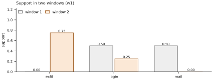

# Demo 79: Contrast-Set Growth Rates Across Adjacent Time Windows

> **▶️ New here? Follow the step-by-step [Execution Instructions](INSTRUCTIONS.md)** — every command with expected output.

## Learning Objectives

- Explain the measurement question of this teaching demonstration
- Run the offline procedure on the labelled synthetic fixture
- Distinguish the teaching output from a confirmatory research result
- Name the target venue and why the topic is scoped to that venue

<!-- BEGIN generated: how-it-works (tools/figures/docs.py) -->
## How it works

**Figure 1.** An item set is emerging when its support grows enough between adjacent windows. Numbered boxes are stages (role on top, rule or variable beneath, in monospace); dashed grey panels mark a trust domain or scope; a dashed red arrow marks where an adversary acts. Teaching schematic: it simplifies the research procedure and leaves out its corpora, models and thresholds.

### Step by step

1. **Window 1** (`items`). Earlier period. In this demo: `fixtures/`.
2. **Window 2** (`items`). Later period. In this demo: `fixtures/`.
3. **Support** (`supp₁, supp₂`). Per item set. In this demo: `student/contrast.py`.
4. **Growth** (`supp₂ / supp₁ ≥ ρ`). Emerging set. In this demo: `student/run_contrast.py`.
5. **Emerging sets** (`growth ≥ ρ`). Per item set. Run `make demo` to print it.

**Figure 2.** An item set is emerging when its support grows at least two-fold and passes the minimum support in the later window. Values come from `make demo` on the synthetic fixture: they are illustrative and are not research results.

### What the research version adds (withheld while under peer review)

- Real event logs
- Significance control for many sets

The study's data, exact protocol, thresholds and results are not part of this teaching demo. They will be linked here once the paper is published open access.

<!-- END generated: how-it-works -->

## Conceptual Explanation

Item support in two windows and the growth rate that marks an emerging contrast set. The fixture holds 8 labelled synthetic cases.
Running `student/run_contrast.py` prints one row per case and writes
`results/contrast.json`. Every number produced here belongs to the
toy fixture; it is not evidence about a live system or an external corpus.

Target venue (option A): **KDD**. Options B and C are
sequential fallbacks and are recorded in `venue.yaml`.

## Safety Notice

⚠️ **This is a teaching demonstration using synthetic fixtures only.**
- No real vulnerabilities, credentials, or production systems
- No network access (standard library only)
- All cases and verdicts are hand-built toys
- Results demonstrate a mechanism; they are not evidence about real deployments

## Reproducibility Metadata

| Field | Value |
|-------|-------|
| Seed | 79 (fixed; no randomness used) |
| Python | 3.11+ (stdlib only) |
| OS | Linux/macOS/Windows |
| Command | `make demo DEMO=79` |

## Research Connection

This demo illustrates the measurement question of a pending study aimed at
KDD. That study has collected no confirmatory data; every
quantity there is `[RESULT PENDING]`. Nothing here describes a publication,
a venue result, or a measured effect size.
