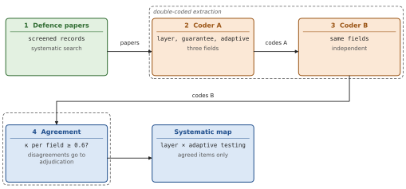
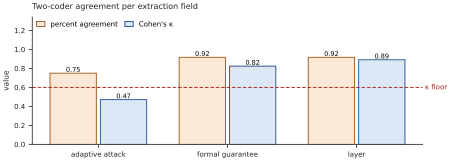

# Demo 80: SoK Extraction Protocol

  
  
  

> **▶️ New here? Follow the step-by-step [Execution Instructions](INSTRUCTIONS.md)** — every command with expected output.

## Learning Objectives

- Run a double-coded extraction over a set of papers
- Compute percent agreement and Cohen's kappa per field
- Send disagreements to adjudication before mapping

<!-- BEGIN generated: how-it-works (tools/figures/docs.py) -->
## How it works

**Figure 1.** Two coders extract the same fields independently; chance-corrected agreement decides whether a field is usable. Numbered boxes are stages (role on top, rule or variable beneath, in monospace); dashed grey panels mark a trust domain or scope; a dashed red arrow marks where an adversary acts. Teaching schematic: it simplifies the research procedure and leaves out its corpora, models and thresholds.

### Step by step

1. **Defence papers** (`screened records`). Systematic search. In this demo: `fixtures/fixtures.json`.
2. **Coder A** (`layer, guarantee, adaptive`). Three fields. In this demo: `fixtures/fixtures.json`.
3. **Coder B** (`same fields`). Independent. In this demo: `fixtures/fixtures.json`.
4. **Agreement** (`κ per field ≥ 0.6?`). Disagreements go to adjudication. In this demo: `student/extract.py`.
5. **Systematic map** (`layer × adaptive testing`). Agreed items only. Run `make demo` to print it.

**Figure 2.** The adaptive-attack field has 75% raw agreement but a kappa below the floor, so it goes to adjudication before the map is drawn. Values come from `make demo` on the synthetic fixture: they are illustrative and are not research results.

### What the research version adds (withheld while under peer review)

- A large screened literature committed in several stages
- A sealed systematic map
- Utility cost and formal guarantee fields

The study's data, exact protocol, thresholds and results are not part of this teaching demo. They will be linked here once the paper is published open access.

<!-- END generated: how-it-works -->

## Conceptual Explanation

A systematisation of knowledge rests on an extraction protocol: two coders independently record the same fields for every included paper. Chance-corrected agreement (Cohen's kappa) decides whether a field is reliable enough to map; items on which the coders disagree are adjudicated before they enter the systematic map.

## Safety Notice

⚠️ **Teaching demonstration only.**
- Synthetic fixtures (`fixtures/fixtures.json`); every name, value and verdict is invented
- No network access, no credentials, standard library only
- Results demonstrate a mechanism; they are not evidence about real systems

## Reproducibility Metadata

| Field | Value |
|-------|-------|
| Randomness | none (deterministic) |
| Python | 3.10+ (standard library only) |
| Command | `make demo` then `make test` |
| Output | `results/extraction.json` |

## Research Connection

This demo distils, in simplified form, the procedure of a study in the author's research programme that is in progress or under peer review. All scenarios, numbers and verdicts here are synthetic and describe no publication.

## Exercise

Resolve the disagreement on `p02` in favour of coder A. Does the adaptive-attack field now meet the 0.6 floor?
