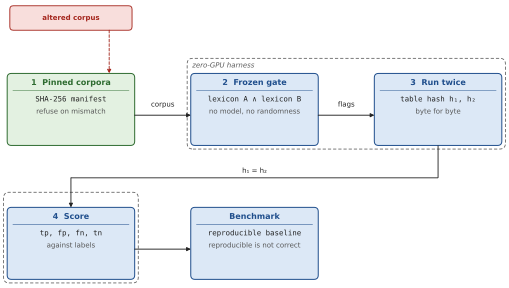
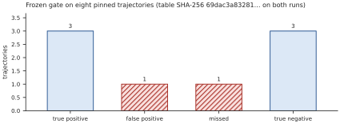

# Demo 81: The Frozen Gate Benchmark

  
  
  

> **▶️ New here? Follow the step-by-step [Execution Instructions](INSTRUCTIONS.md)** — every command with expected output.

## Learning Objectives

- Pin a corpus with SHA-256 and refuse to run on altered data
- Run a frozen, deterministic gate twice and compare the result tables byte for byte
- Distinguish reproducible from correct

<!-- BEGIN generated: how-it-works (tools/figures/docs.py) -->
## How it works

**Figure 1.** Pinned data and a frozen gate make a benchmark re-runnable byte for byte. Numbered boxes are stages (role on top, rule or variable beneath, in monospace); dashed grey panels mark a trust domain or scope; a dashed red arrow marks where an adversary acts. Teaching schematic: it simplifies the research procedure and leaves out its corpora, models and thresholds.

### Step by step

1. **Pinned corpora** (`SHA-256 manifest`). Refuse on mismatch. In this demo: `fixtures/fixtures.json`.
2. **Frozen gate** (`lexicon A ∧ lexicon B`). No model, no randomness. In this demo: `student/harness.py`.
3. **Run twice** (`table hash h₁, h₂`). Byte for byte. In this demo: `student/harness.py`.
4. **Score** (`tp, fp, fn, tn`). Against labels. In this demo: `student/harness.py`.
5. **Benchmark** (`reproducible baseline`). Reproducible is not correct. Run `make demo` to print it.

**Figure 2.** The gate's table is byte-identical on every run; it still misses one attack and flags a security-training trajectory. Values come from `make demo` on the synthetic fixture: they are illustrative and are not research results.

### What the research version adds (withheld while under peer review)

- Many SHA-256-pinned external corpora across four domains
- Baselines packaged for re-use

The study's data, exact protocol, thresholds and results are not part of this teaching demo. They will be linked here once the paper is published open access.

<!-- END generated: how-it-works -->

## Conceptual Explanation

A benchmark is re-runnable only if its data and its scorer are frozen. Here the corpus is pinned by a SHA-256 hash in a manifest and the harness refuses to start if the hash differs (fail closed). A two-lexicon gate with no model and no randomness flags trajectories; running it twice produces a byte-identical table.

## Safety Notice

⚠️ **Teaching demonstration only.**
- Synthetic fixtures (`fixtures/fixtures.json`); every name, value and verdict is invented
- No network access, no credentials, standard library only
- Results demonstrate a mechanism; they are not evidence about real systems

## Reproducibility Metadata

| Field | Value |
|-------|-------|
| Randomness | none (deterministic) |
| Python | 3.10+ (standard library only) |
| Command | `make demo` then `make test` |
| Output | `results/frozen_gate.json` |

## Research Connection

This demo distils, in simplified form, the procedure of a study in the author's research programme that is in progress or under peer review. All scenarios, numbers and verdicts here are synthetic and describe no publication.

## Exercise

Edit one call in the corpus and run the harness. What happens? Then add a phrase to the override lexicon so that `t5` is caught, and update the manifest hash.
