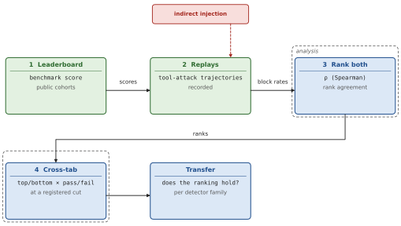
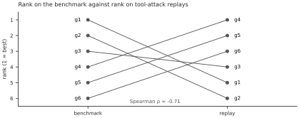

# Demo 82: Guardrail Score Transfer

  
  
  

> **▶️ New here? Follow the step-by-step [Execution Instructions](INSTRUCTIONS.md)** — every command with expected output.

## Learning Objectives

- Rank detectors by a benchmark score and by replay outcomes
- Compute Spearman's rank correlation by hand
- Cross-tabulate benchmark tier against replay verdict

<!-- BEGIN generated: how-it-works (tools/figures/docs.py) -->
## How it works

**Figure 1.** A benchmark ranking is useful only if it survives on the attacks the deployment faces. Numbered boxes are stages (role on top, rule or variable beneath, in monospace); dashed grey panels mark a trust domain or scope; a dashed red arrow marks where an adversary acts. Teaching schematic: it simplifies the research procedure and leaves out its corpora, models and thresholds.

### Step by step

1. **Leaderboard** (`benchmark score`). Public cohorts. In this demo: `fixtures/fixtures.json`.
2. **Replays** (`tool-attack trajectories`). Recorded. In this demo: `fixtures/fixtures.json`.
3. **Rank both** (`ρ (Spearman)`). Rank agreement. In this demo: `student/transfer.py`.
4. **Cross-tab** (`top/bottom × pass/fail`). At a registered cut. In this demo: `student/transfer.py`.
5. **Transfer** (`does the ranking hold?`). Per detector family. Run `make demo` to print it.

**Figure 2.** The content-safety models that lead the benchmark trail on replays; the ranking inverts by family. Values come from `make demo` on the synthetic fixture: they are illustrative and are not research results.

### What the research version adds (withheld while under peer review)

- Many public detectors from five evaluation cohorts
- Threshold collapse across corpora

The study's data, exact protocol, thresholds and results are not part of this teaching demo. They will be linked here once the paper is published open access.

<!-- END generated: how-it-works -->

## Conceptual Explanation

Practitioners pick guardrails from leaderboards and assume the ranking transfers to the attacks their agents face. Ranking the same models by benchmark score and by the share of recorded tool-attack replays each blocks tests that assumption.

## Safety Notice

⚠️ **Teaching demonstration only.**
- Synthetic fixtures (`fixtures/fixtures.json`); every name, value and verdict is invented
- No network access, no credentials, standard library only
- Results demonstrate a mechanism; they are not evidence about real systems

## Reproducibility Metadata

| Field | Value |
|-------|-------|
| Randomness | none (deterministic) |
| Python | 3.10+ (standard library only) |
| Command | `make demo` then `make test` |
| Output | `results/transfer.json` |

## Research Connection

This demo distils, in simplified form, the procedure of a study in the author's research programme that is in progress or under peer review. All scenarios, numbers and verdicts here are synthetic and describe no publication.

## Exercise

Swap the replay outcomes of g3 and g4. What happens to rho and to the cross-tab?
