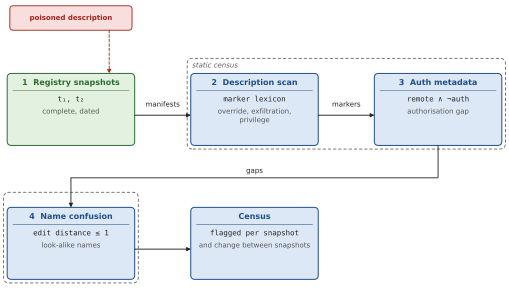
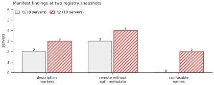

# Demo 83: Manifest Census at Registry Scale

  
  
  

> **▶️ New here? Follow the step-by-step [Execution Instructions](INSTRUCTIONS.md)** — every command with expected output.

## Learning Objectives

- Scan manifest descriptions for injection markers
- Flag remote servers with no authorisation metadata
- Find confusable server names by edit distance

<!-- BEGIN generated: how-it-works (tools/figures/docs.py) -->
## How it works

**Figure 1.** The manifest description is the only text a client sees before connecting, so it is scanned at registry scale. Numbered boxes are stages (role on top, rule or variable beneath, in monospace); dashed grey panels mark a trust domain or scope; a dashed red arrow marks where an adversary acts. Teaching schematic: it simplifies the research procedure and leaves out its corpora, models and thresholds.

### Step by step

1. **Registry snapshots** (`t₁, t₂`). Complete, dated. In this demo: `fixtures/fixtures.json`.
2. **Description scan** (`marker lexicon`). Override, exfiltration, privilege. In this demo: `student/census.py`.
3. **Auth metadata** (`remote ∧ ¬auth`). Authorisation gap. In this demo: `student/census.py`.
4. **Name confusion** (`edit distance ≤ 1`). Look-alike names. In this demo: `student/census.py`.
5. **Census** (`flagged per snapshot`). And change between snapshots. Run `make demo` to print it.

**Figure 2.** Between snapshots a new look-alike server appears with an exfiltration instruction in its description. Values come from `make demo` on the synthetic fixture: they are illustrative and are not research results.

### What the research version adds (withheld while under peer review)

- The complete official registry at two dates
- Tool descriptions from a catalogue
- Deployed-agent checks

The study's data, exact protocol, thresholds and results are not part of this teaching demo. They will be linked here once the paper is published open access.

<!-- END generated: how-it-works -->

## Conceptual Explanation

A tool server's manifest description is the only text a client or a model sees before connecting, and its transport metadata is the only signal of whether it expects credentials. A census scans both, and the server names, at two dated snapshots of a registry.

## Safety Notice

⚠️ **Teaching demonstration only.**
- Synthetic fixtures (`fixtures/fixtures.json`); every name, value and verdict is invented
- No network access, no credentials, standard library only
- Results demonstrate a mechanism; they are not evidence about real systems

## Reproducibility Metadata

| Field | Value |
|-------|-------|
| Randomness | none (deterministic) |
| Python | 3.10+ (standard library only) |
| Command | `make demo` then `make test` |
| Output | `results/census.json` |

## Research Connection

This demo distils, in simplified form, the procedure of a study in the author's research programme that is in progress or under peer review. All scenarios, numbers and verdicts here are synthetic and describe no publication.

## Exercise

Add a server named `pdf-reader2` at t2. Is it confusable? Should edit distance alone decide?
