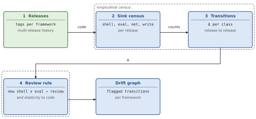
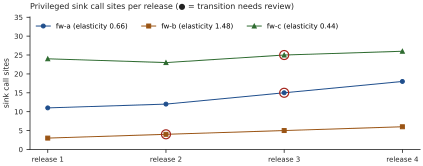

# Demo 84: Longitudinal Drift Matrix

  
  
  

> **▶️ New here? Follow the step-by-step [Execution Instructions](INSTRUCTIONS.md)** — every command with expected output.

## Learning Objectives

- Count privileged call sites per release
- Compute per-transition deltas and a review rule
- Relate sink growth to code growth

<!-- BEGIN generated: how-it-works (tools/figures/docs.py) -->
## How it works

**Figure 1.** A release-by-release census of privileged sinks tells an engineer which upgrades need review. Numbered boxes are stages (role on top, rule or variable beneath, in monospace); dashed grey panels mark a trust domain or scope; a dashed red arrow marks where an adversary acts. Teaching schematic: it simplifies the research procedure and leaves out its corpora, models and thresholds.

### Step by step

1. **Releases** (`tags per framework`). Multi-release history. In this demo: `fixtures/fixtures.json`.
2. **Sink census** (`shell, eval, net, write`). Per release. In this demo: `student/drift.py`.
3. **Transitions** (`Δ per class`). Release to release. In this demo: `student/drift.py`.
4. **Review rule** (`new shell ∨ eval ⇒ review`). And elasticity to code. In this demo: `student/drift.py`.
5. **Drift graph** (`flagged transitions`). Per framework. Run `make demo` to print it.

**Figure 2.** Growth alone does not say which upgrade needs review; the circled transitions add a shell or evaluation call site. Values come from `make demo` on the synthetic fixture: they are illustrative and are not research results.

### What the research version adds (withheld while under peer review)

- Many tags across frameworks and package releases
- Wild cluster bootstrap for elasticity
- A pre-registered outcome linkage

The study's data, exact protocol, thresholds and results are not part of this teaching demo. They will be linked here once the paper is published open access.

<!-- END generated: how-it-works -->

## Conceptual Explanation

Engineers who pin an agent framework must decide how much review each upgrade needs. Counting privileged sinks (shell, code evaluation, network egress, file writes) per release gives a drift matrix; a rule such as 'review any transition that adds a shell or evaluation site' turns it into a review plan.

## Safety Notice

⚠️ **Teaching demonstration only.**
- Synthetic fixtures (`fixtures/fixtures.json`); every name, value and verdict is invented
- No network access, no credentials, standard library only
- Results demonstrate a mechanism; they are not evidence about real systems

## Reproducibility Metadata

| Field | Value |
|-------|-------|
| Randomness | none (deterministic) |
| Python | 3.10+ (standard library only) |
| Command | `make demo` then `make test` |
| Output | `results/drift.json` |

## Research Connection

This demo distils, in simplified form, the procedure of a study in the author's research programme that is in progress or under peer review. All scenarios, numbers and verdicts here are synthetic and describe no publication.

## Exercise

Change the rule to flag any increase in network egress as well. How many transitions now need review?
