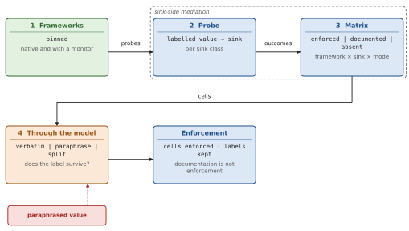
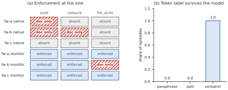

# Demo 85: The Enforcement Matrix

  
  
  

> **▶️ New here? Follow the step-by-step [Execution Instructions](INSTRUCTIONS.md)** — every command with expected output.

## Learning Objectives

- Classify each framework-sink-mode cell as enforced, documented only or absent
- Check whether a token-level provenance label survives a language model
- Explain why documentation is not enforcement

<!-- BEGIN generated: how-it-works (tools/figures/docs.py) -->
## How it works

**Figure 1.** A provenance label protects a sink only if it is enforced there and survives the language model. Numbered boxes are stages (role on top, rule or variable beneath, in monospace); dashed grey panels mark a trust domain or scope; a dashed red arrow marks where an adversary acts. Teaching schematic: it simplifies the research procedure and leaves out its corpora, models and thresholds.

### Step by step

1. **Frameworks** (`pinned`). Native and with a monitor. In this demo: `fixtures/fixtures.json`.
2. **Probe** (`labelled value → sink`). Per sink class. In this demo: `student/matrix.py`.
3. **Matrix** (`enforced | documented | absent`). Framework × sink × mode. In this demo: `student/matrix.py`.
4. **Through the model** (`verbatim | paraphrase | split`). Does the label survive? In this demo: `student/matrix.py`.
5. **Enforcement** (`cells enforced · labels kept`). Documentation is not enforcement. Run `make demo` to print it.

**Figure 2.** No framework enforces provenance at a sink natively; a monitor does, but its token label is lost when the model paraphrases or splits the value. Values come from `make demo` on the synthetic fixture: they are illustrative and are not research results.

### What the research version adds (withheld while under peer review)

- SHA-pinned open-source frameworks
- Live episodes with hosted models
- Label recall and precision against benchmark ground truth

The study's data, exact protocol, thresholds and results are not part of this teaching demo. They will be linked here once the paper is published open access.

<!-- END generated: how-it-works -->

## Conceptual Explanation

Agent frameworks should stop untrusted tool output from steering privileged calls. A recorded probe sends an untrusted-labelled value towards each sink, natively and with an added monitor; the matrix records which cells block it. A second check asks whether a token-level label survives when the model paraphrases or splits the value.

## Safety Notice

⚠️ **Teaching demonstration only.**
- Synthetic fixtures (`fixtures/fixtures.json`); every name, value and verdict is invented
- No network access, no credentials, standard library only
- Results demonstrate a mechanism; they are not evidence about real systems

## Reproducibility Metadata

| Field | Value |
|-------|-------|
| Randomness | none (deterministic) |
| Python | 3.10+ (standard library only) |
| Command | `make demo` then `make test` |
| Output | `results/matrix.json` |

## Research Connection

This demo distils, in simplified form, the procedure of a study in the author's research programme that is in progress or under peer review. All scenarios, numbers and verdicts here are synthetic and describe no publication.

## Exercise

Design a label that would survive the 'split' transform. What would it cost in false positives?
