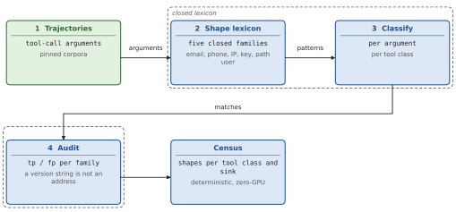
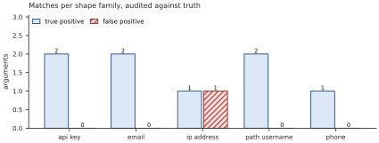

# Demo 86: Personal-Data Exposure Census

  
  
  

> **▶️ New here? Follow the step-by-step [Execution Instructions](INSTRUCTIONS.md)** — every command with expected output.

## Learning Objectives

- Apply a closed lexicon of personal-data shapes to tool-call arguments
- Count matches per tool class
- Audit each family's matches against truth

<!-- BEGIN generated: how-it-works (tools/figures/docs.py) -->
## How it works

**Figure 1.** Personal-data shapes in recorded tool arguments are counted with a closed lexicon whose errors can be audited. Numbered boxes are stages (role on top, rule or variable beneath, in monospace); dashed grey panels mark a trust domain or scope; a dashed red arrow marks where an adversary acts. Teaching schematic: it simplifies the research procedure and leaves out its corpora, models and thresholds.

### Step by step

1. **Trajectories** (`tool-call arguments`). Pinned corpora. In this demo: `fixtures/fixtures.json`.
2. **Shape lexicon** (`five closed families`). Email, phone, IP, key, path user. In this demo: `student/pii.py`.
3. **Classify** (`per argument`). Per tool class. In this demo: `student/pii.py`.
4. **Audit** (`tp / fp per family`). A version string is not an address. In this demo: `student/pii.py`.
5. **Census** (`shapes per tool class and sink`). Deterministic, zero-GPU. Run `make demo` to print it.

**Figure 2.** The closed lexicon is auditable: its one error is a four-part version string read as an IP address. Values come from `make demo` on the synthetic fixture: they are illustrative and are not research results.

### What the research version adds (withheld while under peer review)

- Several pinned trajectory corpora
- Per-sink breakdowns and a registered lexicon

The study's data, exact protocol, thresholds and results are not part of this teaching demo. They will be linked here once the paper is published open access.

<!-- END generated: how-it-works -->

## Conceptual Explanation

Recorded agent trajectories are archived in benchmarks and training corpora, and their tool arguments can carry personal data. A deterministic census applies five closed shape families (email, phone, IP address, API key or token, and a username inside an operating-system path) and counts matches per tool class.

## Safety Notice

⚠️ **Teaching demonstration only.**
- Synthetic fixtures (`fixtures/fixtures.json`); every name, value and verdict is invented
- No network access, no credentials, standard library only
- Results demonstrate a mechanism; they are not evidence about real systems

## Reproducibility Metadata

| Field | Value |
|-------|-------|
| Randomness | none (deterministic) |
| Python | 3.10+ (standard library only) |
| Command | `make demo` then `make test` |
| Output | `results/pii_census.json` |

## Research Connection

This demo distils, in simplified form, the procedure of a study in the author's research programme that is in progress or under peer review. All scenarios, numbers and verdicts here are synthetic and describe no publication.

## Exercise

Tighten the IP pattern so that `pkg==1.2.3.4` no longer matches. Does anything else change?
