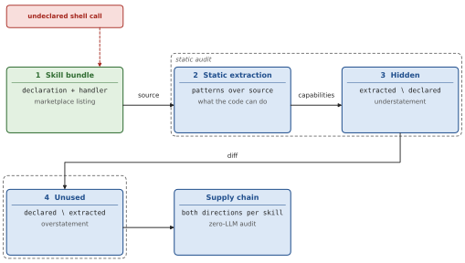
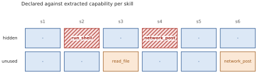

# Demo 87: Declared versus Actual Capability

  
  
  

> **▶️ New here? Follow the step-by-step [Execution Instructions](INSTRUCTIONS.md)** — every command with expected output.

## Learning Objectives

- Extract capabilities statically from a skill handler
- Diff extracted against declared capabilities in both directions
- Explain the risk of each direction

<!-- BEGIN generated: how-it-works (tools/figures/docs.py) -->
## How it works

**Figure 1.** A skill's declaration is compared with what its handler can actually do, in both directions. Numbered boxes are stages (role on top, rule or variable beneath, in monospace); dashed grey panels mark a trust domain or scope; a dashed red arrow marks where an adversary acts. Teaching schematic: it simplifies the research procedure and leaves out its corpora, models and thresholds.

### Step by step

1. **Skill bundle** (`declaration + handler`). Marketplace listing. In this demo: `fixtures/fixtures.json`.
2. **Static extraction** (`patterns over source`). What the code can do. In this demo: `student/diff.py`.
3. **Hidden** (`extracted ∖ declared`). Understatement. In this demo: `student/diff.py`.
4. **Unused** (`declared ∖ extracted`). Overstatement. In this demo: `student/diff.py`.
5. **Supply chain** (`both directions per skill`). Zero-LLM audit. Run `make demo` to print it.

**Figure 2.** Two skills can do more than they declare (a shell call, a network post); two declare capabilities their code never uses. Values come from `make demo` on the synthetic fixture: they are illustrative and are not research results.

### What the research version adds (withheld while under peer review)

- Marketplace listings and public repositories
- Wilson intervals and exact tests

The study's data, exact protocol, thresholds and results are not part of this teaching demo. They will be linked here once the paper is published open access.

<!-- END generated: how-it-works -->

## Conceptual Explanation

Agent skill marketplaces rely on optional declarations. Extracting what a handler can do from its source and comparing it with what the skill declares finds two kinds of mismatch: a hidden capability (extracted but not declared) and an unused declaration (declared but not found).

## Safety Notice

⚠️ **Teaching demonstration only.**
- Synthetic fixtures (`fixtures/fixtures.json`); every name, value and verdict is invented
- No network access, no credentials, standard library only
- Results demonstrate a mechanism; they are not evidence about real systems

## Reproducibility Metadata

| Field | Value |
|-------|-------|
| Randomness | none (deterministic) |
| Python | 3.10+ (standard library only) |
| Command | `make demo` then `make test` |
| Output | `results/capability_diff.json` |

## Research Connection

This demo distils, in simplified form, the procedure of a study in the author's research programme that is in progress or under peer review. All scenarios, numbers and verdicts here are synthetic and describe no publication.

## Exercise

Add a skill whose handler calls `os.system`. Which pattern catches it, and which direction does it fall in?
