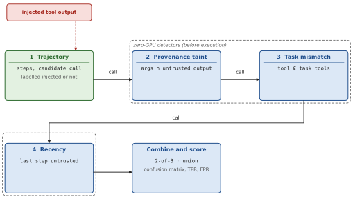
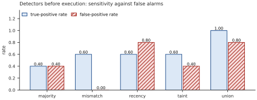

# Demo 88: The Detection Confusion Matrix

  
  
  

> **▶️ New here? Follow the step-by-step [Execution Instructions](INSTRUCTIONS.md)** — every command with expected output.

## Learning Objectives

- Implement three structural detectors for injected actions
- Combine them by majority and by union
- Fill and read a confusion matrix per detector

<!-- BEGIN generated: how-it-works (tools/figures/docs.py) -->
## How it works

**Figure 1.** Three cheap structural cues each catch a different subset of injected actions; combining them trades sensitivity against false alarms. Numbered boxes are stages (role on top, rule or variable beneath, in monospace); dashed grey panels mark a trust domain or scope; a dashed red arrow marks where an adversary acts. Teaching schematic: it simplifies the research procedure and leaves out its corpora, models and thresholds.

### Step by step

1. **Trajectory** (`steps, candidate call`). Labelled injected or not. In this demo: `fixtures/fixtures.json`.
2. **Provenance taint** (`args ∩ untrusted output`). In this demo: `student/confusion.py`.
3. **Task mismatch** (`tool ∉ task tools`). In this demo: `student/confusion.py`.
4. **Recency** (`last step untrusted`). In this demo: `student/confusion.py`.
5. **Combine and score** (`2-of-3 · union`). Confusion matrix, TPR, FPR. Run `make demo` to print it.

**Figure 2.** The union catches every injected action but raises false alarms on most benign ones; task mismatch alone raises none. Values come from `make demo` on the synthetic fixture: they are illustrative and are not research results.

### What the research version adds (withheld while under peer review)

- Attacked benchmark runs with byte-identical reproduction
- False-positive costs and cross-domain transfer

The study's data, exact protocol, thresholds and results are not part of this teaching demo. They will be linked here once the paper is published open access.

<!-- END generated: how-it-works -->

## Conceptual Explanation

Before a tool call runs, cheap structural cues can suggest that it was injected: an argument copied from untrusted output (provenance taint), a tool outside the task's set (task mismatch), or a call made right after untrusted content (recency). Each catches a different subset; combining them trades sensitivity against false alarms.

## Safety Notice

⚠️ **Teaching demonstration only.**
- Synthetic fixtures (`fixtures/fixtures.json`); every name, value and verdict is invented
- No network access, no credentials, standard library only
- Results demonstrate a mechanism; they are not evidence about real systems

## Reproducibility Metadata

| Field | Value |
|-------|-------|
| Randomness | none (deterministic) |
| Python | 3.10+ (standard library only) |
| Command | `make demo` then `make test` |
| Output | `results/detection.json` |

## Research Connection

This demo distils, in simplified form, the procedure of a study in the author's research programme that is in progress or under peer review. All scenarios, numbers and verdicts here are synthetic and describe no publication.

## Exercise

Which single change to the recency rule would cut its false positives without losing a true positive?
