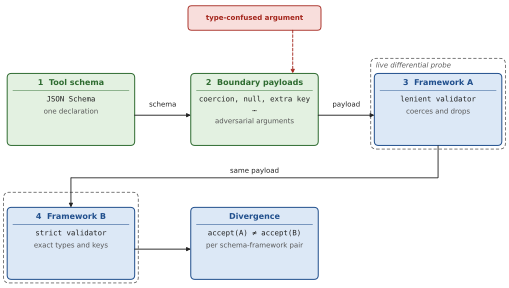
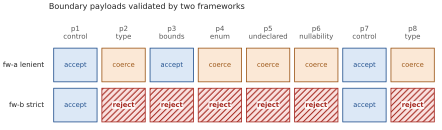

# Demo 89: Tool-Schema Interpretation Divergence

  
  
  

> **▶️ New here? Follow the step-by-step [Execution Instructions](INSTRUCTIONS.md)** — every command with expected output.

## Learning Objectives

- Run boundary payloads through two validators of the same schema
- Classify each divergence by dimension
- Explain why a schema is not a gate

<!-- BEGIN generated: how-it-works (tools/figures/docs.py) -->
## How it works

**Figure 1.** The same schema becomes a different gate in each framework; a differential probe shows where. Numbered boxes are stages (role on top, rule or variable beneath, in monospace); dashed grey panels mark a trust domain or scope; a dashed red arrow marks where an adversary acts. Teaching schematic: it simplifies the research procedure and leaves out its corpora, models and thresholds.

### Step by step

1. **Tool schema** (`JSON Schema`). One declaration. In this demo: `fixtures/fixtures.json`.
2. **Boundary payloads** (`coercion, null, extra key …`). Adversarial arguments. In this demo: `fixtures/fixtures.json`.
3. **Framework A** (`lenient validator`). Coerces and drops. In this demo: `student/divergence.py`.
4. **Framework B** (`strict validator`). Exact types and keys. In this demo: `student/divergence.py`.
5. **Divergence** (`accept(A) ≠ accept(B)`). Per schema-framework pair. Run `make demo` to print it.

**Figure 2.** Six of eight payloads are accepted by one framework and rejected by the other; only the controls agree. Values come from `make demo` on the synthetic fixture: they are illustrative and are not research results.

### What the research version adds (withheld while under peer review)

- Live probes across several frameworks
- A static interpretation analysis

The study's data, exact protocol, thresholds and results are not part of this teaching demo. They will be linked here once the paper is published open access.

<!-- END generated: how-it-works -->

## Conceptual Explanation

Agent frameworks share tool schemas but validate arguments differently. A differential probe sends the same boundary payloads (type coercion, bounds, enum case, undeclared keywords, nullability) through two interpretations of one schema and records where they disagree.

## Safety Notice

⚠️ **Teaching demonstration only.**
- Synthetic fixtures (`fixtures/fixtures.json`); every name, value and verdict is invented
- No network access, no credentials, standard library only
- Results demonstrate a mechanism; they are not evidence about real systems

## Reproducibility Metadata

| Field | Value |
|-------|-------|
| Randomness | none (deterministic) |
| Python | 3.10+ (standard library only) |
| Command | `make demo` then `make test` |
| Output | `results/divergence.json` |

## Research Connection

This demo distils, in simplified form, the procedure of a study in the author's research programme that is in progress or under peer review. All scenarios, numbers and verdicts here are synthetic and describe no publication.

## Exercise

Make the lenient validator reject undeclared keywords. Which divergences remain?
