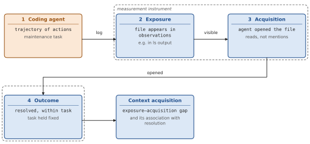
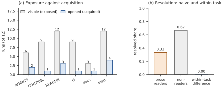

# Demo 90: The Unread Manual

  
  
  

> **▶️ New here? Follow the step-by-step [Execution Instructions](INSTRUCTIONS.md)** — every command with expected output.

## Learning Objectives

- Separate exposure (a file was visible) from acquisition (the file was opened) in an agent's action log
- Measure when guidance is read relative to the first edit
- Compare outcomes within the same task before reading anything into an association

<!-- BEGIN generated: how-it-works (tools/figures/docs.py) -->
## How it works

**Figure 1.** Guidance a repository writes for agents is visible far more often than it is read. Numbered boxes are stages (role on top, rule or variable beneath, in monospace); dashed grey panels mark a trust domain or scope; a dashed red arrow marks where an adversary acts. Teaching schematic: it simplifies the research procedure and leaves out its corpora, models and thresholds.

### Step by step

1. **Coding agent** (`trajectory of actions`). Maintenance task. In this demo: `fixtures/fixtures.json`.
2. **Exposure** (`file appears in observations`). E.g. in ls output. In this demo: `student/acquisition.py`.
3. **Acquisition** (`agent opened the file`). Reads, not mentions. In this demo: `student/acquisition.py`.
4. **Outcome** (`resolved, within task`). Task held fixed. In this demo: `student/acquisition.py`.
5. **Context acquisition** (`exposure–acquisition gap`). And its association with resolution. Run `make demo` to print it.

**Figure 2.** README is visible in every run and opened in three; the naive comparison says readers resolve less often, but within the same task the difference vanishes. Values come from `make demo` on the synthetic fixture: they are illustrative and are not research results.

### What the research version adds (withheld while under peer review)

- Public trajectory corpora across many harnesses
- Task fixed effects and trajectory-length controls
- A push-policy comparison on the same tasks

The study's data, exact protocol, thresholds and results are not part of this teaching demo. They will be linked here once the paper is published open access.

<!-- END generated: how-it-works -->

## Conceptual Explanation

Repository owners write guidance for coding agents (README, CONTRIBUTING, AGENTS.md, docs) on the assumption that it will be read. An agent's own action log records what it consulted. A naive count of mentions says every agent saw the README, because it appears in a directory listing; counting reads gives a very different answer. Whether reading predicts success must then be checked within the same task, because harder tasks prompt more reading.

## Safety Notice

⚠️ **Teaching demonstration only.**
- Synthetic fixtures (`fixtures/fixtures.json`); every name, value and verdict is invented
- No network access, no credentials, standard library only
- Results demonstrate a mechanism; they are not evidence about real systems

## Reproducibility Metadata

| Field | Value |
|-------|-------|
| Randomness | none (deterministic) |
| Python | 3.10+ (standard library only) |
| Command | `make demo` then `make test` |
| Output | `results/context_acquisition.json` |

## Research Connection

This demo distils, in simplified form, the procedure of a study in the author's research programme that is in progress or under peer review. All scenarios, numbers and verdicts here are synthetic and describe no publication.

## Exercise

Make r06 open README.md before editing and resolve the task. What happens to the naive and the within-task comparisons?
